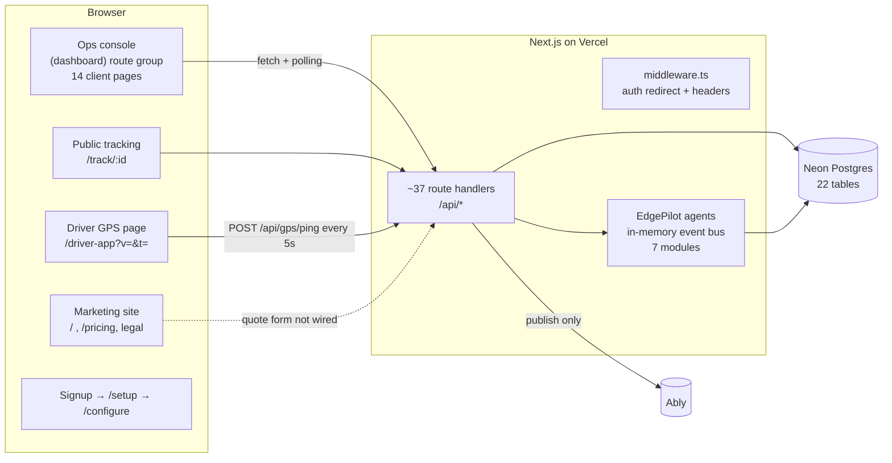
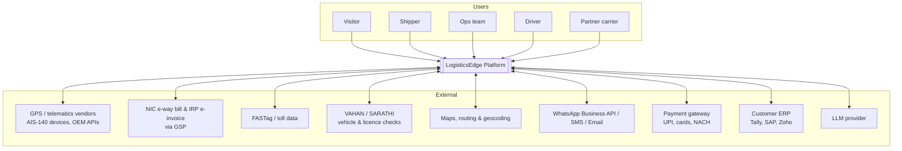
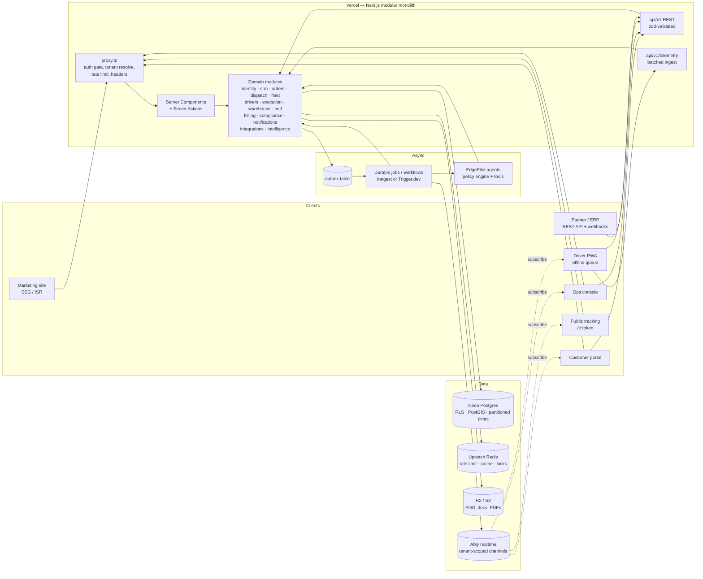
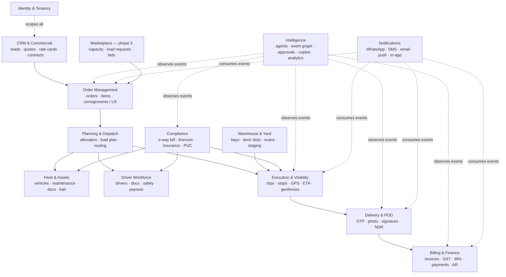
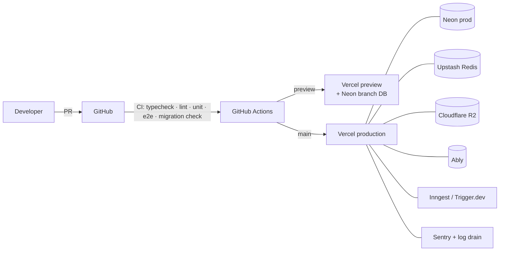

# LogisticsEdge — High-Level Design (HLD)

| | |
|---|---|
| **Product** | LogisticsEdge — India-first Logistics Operating System (TMS + Fleet + Visibility + Billing + AI agents) |
| **Version** | 1.0 (first formal HLD) |
| **Date** | 2026-10-17 |
| **Status** | Draft for review |
| **Companion docs** | [LLD.md](./LLD.md) (low-level design) · [GAP_ANALYSIS.md](./GAP_ANALYSIS.md) (audit, benchmark, roadmap) |

> **How to read this doc.** Section 3 describes the system **as it is built today** (verified against the code on 2026-10-17). Sections 4 onward describe the **target architecture** we should evolve toward. Every target decision is chosen so it can be reached incrementally from the current Next.js + Neon codebase — no rewrite.

---

## 1. Purpose & scope

LogisticsEdge is a multi-tenant SaaS for Indian road-freight operators (fleet owners, 3PLs, brokers, cold-chain and last-mile operators — see the archetypes in `src/lib/onboarding/scoring.ts`). It covers the full shipment lifecycle:

```
Lead → Quote → Order → Plan/Allocate → Load (warehouse/bay) → Dispatch → Track → Deliver (POD) → Invoice (GST) → Collect
```

with an AI operations layer ("EdgePilot") that watches every event and either acts or asks a human.

**In scope:** marketing website, customer (shipper) portal, operations console, driver app, public tracking, partner/public API, AI agents, integrations (GPS, GST/e-way bill, payments, messaging).

**Out of scope for v1:** ocean/air freight forwarding, customs brokerage, full WMS (pick/pack/putaway). Inventory is kept to staging and bay level.

---

## 2. Actors & personas

| Actor | Channel | Primary jobs |
|---|---|---|
| **Visitor / prospect** | Marketing site | Understand the product, get an instant quote, start a trial, track a shipment |
| **Shipper (customer)** | Customer portal, WhatsApp, API | Book shipments, see live status and ETA, download POD and invoices, pay |
| **Operations Director** | Ops console | KPIs, approvals, autonomy policy, billing oversight |
| **Fleet Dispatcher** | Ops console | Allocate vehicles and drivers, monitor trips, resolve exceptions, chat with drivers |
| **Warehouse / bay supervisor** | Ops console (tablet) | Dock appointments, barcode scan, load verification |
| **Compliance officer** | Ops console | Licence, insurance and PUC expiry, e-way bill validity, audit |
| **Finance / AR** | Ops console | Invoices, e-invoice IRN, payments, collections, disputes |
| **Driver** | Driver app (PWA), WhatsApp | Accept trips, navigate, share GPS, report issues, capture POD |
| **Partner carrier / broker** | Partner portal / API | Receive tenders, accept loads, post capacity *(marketplace phase)* |
| **Platform admin** | Admin console | Tenants, plans, usage, support |
| **External systems** | API / webhooks | GPS vendors, NIC e-way bill / IRP, FASTag, payment gateway, ERP (Tally, SAP) |

---

## 3. Current architecture (as built)

### 3.1 Stack

| Layer | Technology (from `package.json`) |
|---|---|
| Web framework | Next.js 16.3 (App Router, Turbopack), React 19.2, TypeScript 5 |
| Styling | Tailwind CSS v4 + CSS variables in `src/app/globals.css`, Lucide icons, `motion` |
| Forms | react-hook-form + zod (used in a few forms only) |
| Charts / maps | Recharts; Leaflet with raw OpenStreetMap tiles |
| Database | Neon serverless Postgres through **`drizzle-orm/neon-http`** (`src/lib/db.ts`) |
| Auth | Custom HMAC-SHA256 signed cookie (`src/lib/auth.ts`), bcrypt passwords |
| Realtime | Ably REST publish (`src/lib/ably-server.ts`). **No client subscribes**; the UI polls. |
| PDF | `@react-pdf/renderer` (GST invoice) |
| Hosting | Vercel (one cron in `vercel.json`) |

### 3.2 Logical view (today)



### 3.3 Key characteristics of the current build

- **Shape:** a single Next.js app. Pages are almost all `'use client'`. Data is fetched in `useEffect` hooks (`src/features/*/hooks.ts`) that call REST route handlers. Each route handler queries Drizzle directly, so there is no service layer.
- **Feature slices:** `src/features/<domain>/{hooks,types,components}` is a good foundation and maps cleanly onto the target bounded contexts.
- **Tenancy:** the `tenants`, `tenant_subscriptions`, `tenant_modules`, `tenant_configs` and `usage_counters` tables exist, but **none of the operational tables carry `tenant_id`**. All customers share one dataset. Module entitlements are read from `localStorage` (`src/lib/entitlements/index.ts:106`).
- **Agents:** a clean, decoupled contract (`src/lib/agents/core/types.ts`) with 7 modules. They run synchronously inside the HTTP request on an in-memory bus with no durability or retries. "NLU" is keyword regex. Tool execution is simulated.
- **Docs drift:** `docs/schema.sql` describes a different, more normalised schema (organizations, warehouses, bays, order_items, PODs, telematics_logs) than the Drizzle schema actually running (`src/lib/schema.ts`). The README claims Zustand, which the code does not use.

> The full list of defects (including five endpoints that always fail at runtime) is in [GAP_ANALYSIS.md §2](./GAP_ANALYSIS.md#2-critical-defects-p0--fix-before-any-customer-uses-it).

---

## 4. Architecture goals & principles (target)

1. **Tenant isolation by construction.** Every row carries `tenant_id`. Every query goes through a tenant-scoped repository. Postgres Row-Level Security is the backstop.
2. **Modular monolith first.** One deployable Next.js app with hard module boundaries (`src/server/modules/*`). Split out a service only when scale or team size requires it. The GPS ingest service is the most likely first split.
3. **Commands, not CRUD.** State changes happen through explicit domain commands (`allocateOrder`, `startTrip`, `capturePod`, `issueInvoice`), each validated, authorised, transactional and audited. No `PATCH set(body)`.
4. **Event-driven side-effects.** Commands write a domain event to an **outbox** in the same transaction. Durable workers fan out to agents, notifications, webhooks, ETA recompute and analytics.
5. **Human-in-the-loop AI.** Agents propose. The policy engine (tenant autonomy level plus financial limits) decides whether to auto-execute or queue for approval. Every AI action is explainable (evidence) and reversible where possible.
6. **Real data or no data.** Dashboards never show fabricated fallback numbers. Empty states teach the user what to do next.
7. **India-first compliance.** GST (CGST, SGST, IGST; GTA under RCM or FCM), e-invoice IRN, e-way bill (including Part-B updates and extensions), DPDP Act 2023, and VAHAN/SARATHI verification are first-class.
8. **Realtime by default.** Live map, trip timeline, approvals queue and chat update over websockets (Ably), with polling only as a fallback.
9. **Offline-tolerant driver experience.** Low-network highways are normal: the driver app queues pings, POD and messages locally and syncs later.

---

## 5. Target system context



---

## 6. Target container architecture



### 6.1 Container responsibilities

| Container | Responsibility | Key tech |
|---|---|---|
| **Marketing site** | SEO, instant quote, live demo tracking, pricing calculator, trial signup, lead capture | Next.js SSG/ISR, MDX case studies |
| **Customer portal** | Book and bulk-upload shipments, track, ETA, POD and invoice download, pay, raise disputes, API keys | RSC + TanStack Query + Ably |
| **Ops console** | Control tower, allocation, warehouse, trips, live map, approvals queue, billing, compliance, analytics | RSC + client islands, TanStack Table, MapLibre |
| **Driver PWA** | OTP login, trip list, navigation hand-off, GPS share, check-in/out at stops, POD (OTP, photo, signature), chat, expenses | Service worker, IndexedDB queue, Background Sync |
| **Public tracking** | Branded, unguessable-token shipment page with live position, ETA and POD | RSC + read-only Ably token |
| **REST API v1** | Public and partner API with API keys, idempotency, webhooks | Route handlers + zod + OpenAPI |
| **Telemetry ingest** | High-rate GPS ingest, latest-position cache, geofence evaluation | Batched inserts, device tokens |
| **Domain modules** | All business rules, one folder per bounded context | TypeScript services + repositories |
| **Outbox + jobs** | Reliable side-effects, retries, schedules (SLA timers, compliance cron, dunning) | Postgres outbox + Inngest/Trigger.dev |
| **EdgePilot agents** | Exception detection, driver NLU, freight audit, POD chase, collections, customer updates | Durable functions + LLM gateway + typed tools |

---

## 7. Bounded contexts (domain modules)



**Rule:** a module may call another module only through its public service interface (`src/server/modules/<m>/index.ts`). It never touches another module's tables directly. Cross-module side-effects go through domain events.

---

## 8. Core end-to-end flows (summary)

Detailed sequence diagrams are in [LLD §6](./LLD.md#6-key-sequence-flows).

| # | Flow | Path |
|---|---|---|
| F1 | **Instant quote → booking** | Visitor enters pincodes and weight → routing distance → rate card → price band → signup or booking → order `BOOKED` |
| F2 | **Allocate & dispatch** | Dispatcher (or the auto-planner) scores vehicles → `allocateOrder` (txn: order + vehicle + driver + trip) → driver gets a WhatsApp/PWA push → accepts → e-way bill Part-B updated |
| F3 | **Live tracking** | Driver PWA or GPS device → telemetry ingest → latest position + geofence + ETA → Ably → console map, customer portal, public page |
| F4 | **Exception self-healing** | Halt or deviation detected → Exception agent proposes action → policy engine → auto-execute or approval queue → customer notified with a revised ETA |
| F5 | **POD → invoice → cash** | Driver captures OTP, photo and signature (offline OK) → upload → trip `COMPLETED` → Billing agent drafts invoice → IRN → sent to customer → payment link → reconciliation |
| F6 | **Compliance sweep** | Nightly job → licence, insurance, PUC and permit expiry, e-way bill expiry → alerts + auto-suspension of non-compliant assets from allocation |

---

## 9. Data architecture (summary)

- **Primary store:** Neon Postgres (serverless, branching per preview deployment, point-in-time recovery).
- **Driver:** switch from `neon-http` to **`drizzle-orm/neon-serverless` (WebSocket `Pool`)** so interactive transactions work. Keep `neon-http` only for read-only edge paths if needed.
- **Tenancy:** `tenant_id NOT NULL` on every business table. Composite indexes lead with `tenant_id`. RLS policies use `current_setting('app.tenant_id')`, set per transaction.
- **Identifiers:** UUIDv7 primary keys. Human-readable numbers (`ORD-2026-000123`) come from a per-tenant counter table inside the same transaction. Public tracking uses a separate random token.
- **Money:** integer paise (`bigint`), plus a currency code on the tenant.
- **Time:** `timestamptz` everywhere (several columns are free-text today).
- **Geo:** PostGIS `geography(Point)` for locations, geofences and pings, with GiST indexes.
- **Telemetry:** `gps_pings` range-partitioned by month. A `vehicle_positions` table holds the latest position per vehicle (one row each, upserted). Raw pings are kept 90 days hot, then downsampled.
- **Files:** R2/S3 behind presigned URLs. The DB stores only metadata in `documents`.
- **Analytics:** start with SQL views and materialised views. Add a warehouse (BigQuery or ClickHouse) once event volume justifies it.
- **Migrations:** `drizzle-kit generate` + `migrate` in CI. Never use `db:push` against production.

Full ERD: [LLD §3](./LLD.md#3-data-model).

---

## 10. Integration architecture

| Integration | Purpose | Pattern |
|---|---|---|
| GPS / telematics (AIS-140 devices, OEM APIs) | Hardware location, ignition, fuel | Vendor webhook or poller → telemetry ingest. Adapter per vendor. |
| Driver phone GPS | Zero-hardware tracking | PWA → batched ingest with a device token |
| SIM / consent-based tracking | Tracking without an app | Telecom-triangulation vendor (driver consent) |
| NIC e-way bill (via GSP) | Generate, update Part-B, extend, cancel | Outbound adapter + retry. Validity timers drive compliance alerts. |
| IRP e-invoice (via GSP) | IRN + signed QR on B2B invoices | Called during `issueInvoice` |
| FASTag | Toll-crossing events as free checkpoints | Poll or webhook → operational events |
| VAHAN / SARATHI | Verify RC, fitness, insurance; driving licence | On-demand + nightly re-verify |
| Maps, routing, geocoding | Distance, ETA, geocode addresses and pincodes | Provider-agnostic `RoutingService` (OSRM/GraphHopper self-hosted, or a Google/MapTiler API) |
| WhatsApp Business API | Driver and customer comms, templates | Outbound + inbound webhook → `DRIVER_MESSAGE_RECEIVED` |
| Payment gateway | Payment links, UPI, card, NACH, subscription billing | Webhook → `PAYMENT_RECEIVED` → reconcile |
| ERP (Tally, SAP, Zoho) | Order intake, invoice export | REST API + CSV/Excel import + webhooks |
| LLM provider | Driver NLU (Hindi/Hinglish), copilot, OCR of LR/invoices, drafting | `LlmGateway` with model routing, budget, PII redaction |

All adapters follow one contract: **idempotent**, **retried with backoff by the job runner**, **logged to `integration_calls`**, and **mockable** in tests.

---

## 11. Security architecture

| Concern | Design |
|---|---|
| Authentication | Staff: email + password (bcrypt) with optional TOTP MFA, or SSO later. Drivers: phone OTP with a long-lived device token. API: hashed API keys per tenant. |
| Sessions | Short-lived signed access cookie plus a server-side `sessions` row (revocable). Rotate on privilege change. |
| Authorisation | RBAC (`role → permissions`) plus resource scoping (tenant, branch). Checked in every command via `authorize(ctx, 'order.allocate')`. |
| Tenant isolation | Tenant-scoped repositories + Postgres RLS + tests that try cross-tenant access |
| Input validation | zod schema on every endpoint. Allow-listed fields only. |
| Rate limiting | Upstash Redis sliding window on login, OTP, public tracking, quote and ingest |
| Public endpoints | Tracking by random token, never sequential ID. PII minimised (no driver phone; masked vehicle number if the tenant chooses). |
| Secrets | Vercel env vars. Fail closed when `AUTH_SECRET` is missing in production. |
| Headers | One source of truth for CSP and Permissions-Policy, scoped per route (geolocation allowed on the driver app) |
| Audit | Append-only `audit_logs` for every command (who, what, before → after) |
| Privacy (DPDP Act 2023) | Consent records (driver location, marketing), data-principal export and delete, retention policy, breach runbook |
| Webhooks out | HMAC-signed payloads, retries, per-endpoint secrets |

---

## 12. Non-functional requirements

| NFR | Target |
|---|---|
| Availability | 99.9% monthly for console and API. Ingest degrades gracefully: the driver app keeps queuing. |
| Latency | p95 < 300 ms for console API reads, < 150 ms for ingest ack, < 2 s live-position fan-out |
| Scale (v1 design point) | 5,000 active vehicles at 1 ping per 15 s ≈ 330 pings/s (batched), 50,000 orders/month per large tenant |
| Data durability | Neon PITR. RPO ≤ 15 min, RTO ≤ 1 h. Object storage versioning on PODs. |
| Security | OWASP ASVS L2. Zero cross-tenant reads (enforced by tests and RLS). |
| Accessibility | WCAG 2.1 AA on portal, console and tracking |
| Localisation | English + Hindi UI. Driver app in English, Hindi and regional languages over time. INR formatting. |
| Performance budget | Marketing LCP < 2.5 s on 4G. Hero animation ≤ 2 MB initial (today 12 MB of frames). |
| Observability | Structured logs, traces (OpenTelemetry), Sentry errors, uptime checks, business SLOs (on-time %, ingest lag) |

---

## 13. Deployment view



Environments: `local` → `preview` (per PR, Neon branch, seeded demo tenant) → `staging` → `production`.

---

## 14. Key architecture decisions

| ID | Decision | Why | Alternatives considered |
|---|---|---|---|
| ADR-01 | Stay on a Next.js modular monolith | Fastest path from the current code. One deploy. Server Components cut client JS. | Separate NestJS API (more ops overhead, not needed yet) |
| ADR-02 | `neon-serverless` Pool driver for writes | `neon-http` throws on `db.transaction()`, which breaks allocation, trips, delivery and invoicing today | Local Postgres via `pg` (fine off-Vercel) |
| ADR-03 | Shared-schema multi-tenancy + RLS | Cheapest at SaaS scale, simple migrations | Schema-per-tenant (migration pain), DB-per-tenant (cost) |
| ADR-04 | Transactional outbox + durable job runner | Reliable side-effects on serverless. Retries. Agent steps become durable. | In-memory event bus (today; loses work on timeout) |
| ADR-05 | Ably for realtime | Already a dependency. Serverless-friendly. Token auth with channel capabilities. | Pusher, Supabase Realtime, self-hosted WS |
| ADR-06 | MapLibre GL + a tile provider | Vector maps, clustering, smooth live trucks. Licence-friendly. | Leaflet + raw OSM tiles (today; OSM tile policy forbids heavy commercial use, and attribution is currently disabled) |
| ADR-07 | LLM behind a gateway, rules as fallback | Hindi/Hinglish NLU and drafting need an LLM. Deterministic rules keep the system safe when the LLM is down or over budget. | Regex only (today) |
| ADR-08 | PWA driver app first, native later | Ships with the web codebase. Background Sync covers offline. | React Native / Expo (when background GPS reliability demands it) |

---

## 15. Evolution path

| Phase | Theme | Exit criteria |
|---|---|---|
| **0 — Stabilise** | Fix P0 defects | Allocation, trip, delivery and invoice flows work end-to-end. No unauthenticated mutating endpoints. |
| **1 — Foundation** | Tenancy, RBAC, service layer, migrations, tests, outbox | Two tenants cannot see each other's data (proven by tests). CI green on every PR. |
| **2 — Core ops depth** | Trip stops, real maps, routing and ETA, driver PWA, POD storage, GST-correct invoicing, e-way bill | A real fleet runs a week of operations on it |
| **3 — Customer experience** | Customer portal, instant quote, branded tracking, WhatsApp notifications, payments | A shipper self-serves booking → tracking → POD → pay |
| **4 — Intelligence** | LLM driver NLU, predictive and explainable ETA, copilot ("ask your data"), freight audit | Measurable hours saved and leakage caught, from real data only |
| **5 — Network** | Partner API, carrier tendering, ambry-style capacity marketplace | External carriers transact through the platform |

Detailed backlog: [GAP_ANALYSIS.md §8](./GAP_ANALYSIS.md#8-roadmap).
