# LogisticsEdge — Low-Level Design (LLD)

| | |
|---|---|
| **Version** | 1.0 |
| **Date** | 2026-10-17 |
| **Status** | Draft for review |
| **Parent** | [HLD.md](./HLD.md) |
| **Audience** | Engineers implementing phases 0–3 of the roadmap |

> This LLD is written **against the existing code**. Each section names the current files it replaces or extends, so the migration can happen module by module.

---

## Contents

1. [Conventions](#1-conventions)
2. [Code structure](#2-code-structure)
3. [Data model](#3-data-model)
4. [State machines](#4-state-machines)
5. [API design](#5-api-design)
6. [Key sequence flows](#6-key-sequence-flows)
7. [Module designs](#7-module-designs)
8. [Frontend design](#8-frontend-design)
9. [Driver PWA](#9-driver-pwa)
10. [Cross-cutting concerns](#10-cross-cutting-concerns)
11. [Migration plan from the current code](#11-migration-plan-from-the-current-code)

---

## 1. Conventions

| Topic | Rule |
|---|---|
| Language | TypeScript `strict`. No `any` in `src/server/**`. |
| Validation | Every input crosses a zod schema. Schemas live in `src/server/modules/<m>/schemas.ts` and are shared with forms. |
| Errors | Throw `AppError(code, message, httpStatus, details?)`. Route handlers map it to the error envelope ([§5.2](#52-response--error-envelope)). |
| Time | Store `timestamptz` in UTC. Render in the tenant timezone (default `Asia/Kolkata`). Never store display strings such as `"10:30 AM"`. |
| Money | `bigint` paise in the DB, `Money` value object in code, `Intl.NumberFormat('en-IN', { currency })` at the UI edge |
| IDs | `uuid` v7 PK (`id`) plus a per-tenant human number (`number`, e.g. `ORD-2026-000123`) |
| Naming | Tables `snake_case` plural. Columns `snake_case`. Drizzle fields `camelCase`. Domain events `PAST_TENSE_UPPER` (`ORDER_ALLOCATED`). |
| Tenancy | Every business table has `tenant_id uuid NOT NULL`. No query runs without a `TenantContext`. |
| Concurrency | Mutable aggregates have `version int`. Commands use `WHERE id = $1 AND version = $2` (optimistic locking). |
| Soft delete | `archived_at timestamptz` on master data (customers, vehicles, drivers). Transactional records are never deleted. |

---

## 2. Code structure

### 2.1 Target layout

```text
src/
  app/
    (marketing)/            # SSG/ISR: /, /pricing, /solutions/*, /quote, /legal/*
    (auth)/                 # /login, /signup, /verify, /forgot
    (portal)/portal/...     # customer (shipper) portal
    (ops)/...               # ops console (today's (dashboard) group)
    d/                      # driver PWA  (replaces /driver-app)
    t/[token]/              # public tracking (replaces /track/[id])
    api/
      v1/...                # versioned REST (public + console)
      webhooks/<provider>/  # inbound: whatsapp, payments, gps vendors
      jobs/                 # job-runner endpoint (Inngest/Trigger.dev)
  proxy.ts                  # Next 16 name for middleware.ts
  server/
    core/                   # db, tx, tenant context, authz, errors, outbox, ids, money, logger
    modules/
      identity/  crm/  orders/  dispatch/  fleet/  drivers/
      execution/ warehouse/ pod/  billing/  compliance/
      notifications/  integrations/  intelligence/
        <module>/
          index.ts          # public service API (the only import other modules use)
          schemas.ts        # zod input/output
          service.ts        # commands + queries
          repo.ts           # tenant-scoped Drizzle queries
          policies.ts       # authz rules
          events.ts         # domain event types emitted
          *.test.ts
  features/                 # client-side UI slices (kept; hooks move to TanStack Query)
  components/               # design system (kept)
  lib/                      # client-safe utilities only
```

### 2.2 Mapping from today's code

| Today | Target |
|---|---|
| `src/lib/db.ts` (neon-http) | `src/server/core/db.ts` (neon-serverless `Pool` + `withTx`) |
| `src/lib/auth.ts` | `src/server/modules/identity/session.ts` + `src/server/core/authz.ts` |
| `src/middleware.ts` | `src/proxy.ts` (Next 16 convention) |
| `src/app/api/<entity>/route.ts` (direct Drizzle) | thin handlers → `modules/<m>/service.ts` |
| `src/lib/agents/core/*` | `src/server/modules/intelligence/{bus,policy,tools,agents}` on top of outbox + jobs |
| `src/lib/entitlements` (localStorage) | `identity.getEntitlements(tenantId)`, server-side, cached |
| `src/features/*/hooks.ts` (`useEffect` + `fetch`) | TanStack Query hooks + Ably invalidation |

---

## 3. Data model

### 3.1 Identity, tenancy & commercial

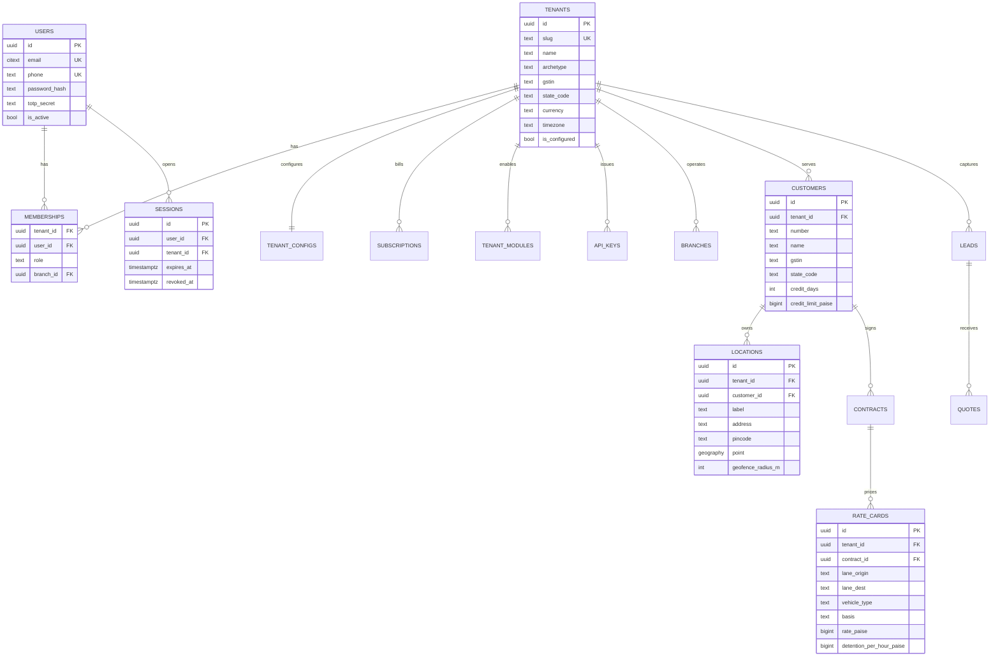

### 3.2 Orders, planning & execution

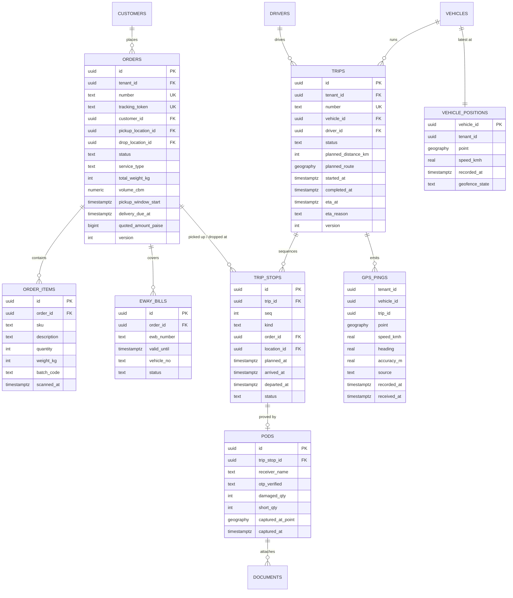

### 3.3 Fleet & drivers

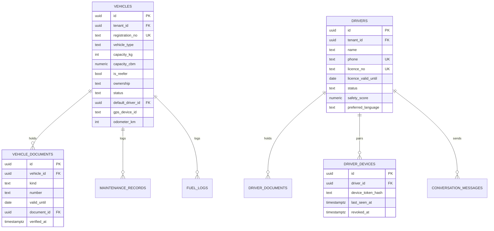

### 3.4 Billing & finance

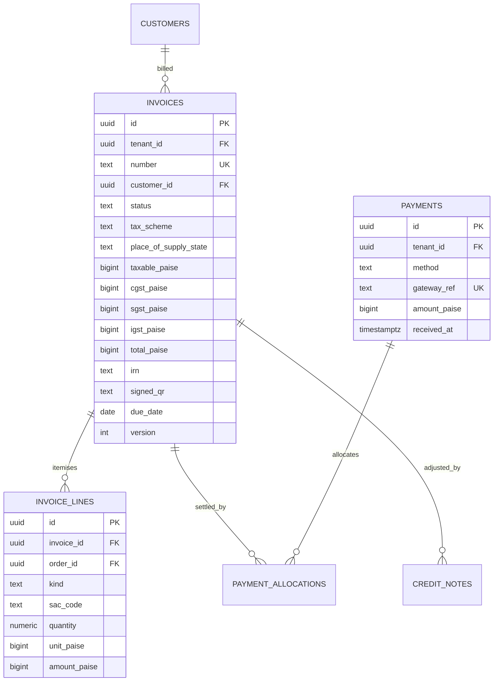

### 3.5 Intelligence, events & platform

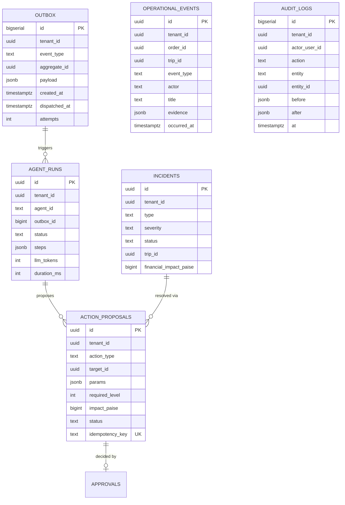

Other platform tables: `notifications`, `notification_templates`, `webhook_endpoints`, `webhook_deliveries`, `integration_calls`, `documents` (file metadata: `storage_key`, `mime`, `sha256`, `size`), `tenant_counters`, `usage_counters`, `consents`, `knowledge_articles`, `system_alerts`.

### 3.6 Indexing strategy

| Table | Index | Serves |
|---|---|---|
| `orders` | `(tenant_id, status, delivery_due_at)` | Dispatch queue, SLA risk |
| `orders` | `(tenant_id, customer_id, created_at desc)` | Customer portal lists |
| `orders` | `UNIQUE (tracking_token)` | Public tracking |
| `trips` | `(tenant_id, status)` partial `WHERE status IN ('IN_TRANSIT','AT_STOP')` | Live map |
| `trip_stops` | `(trip_id, seq)` unique | Route rendering |
| `gps_pings` | partition by month on `recorded_at`; `(vehicle_id, recorded_at desc)` | Replay, ETA |
| `vehicle_positions` | GiST on `point` | Nearest-vehicle allocation |
| `locations` | GiST on `point`; `(tenant_id, pincode)` | Geofence, geocode cache |
| `invoices` | `(tenant_id, status, due_date)` | AR ageing, dunning |
| `outbox` | `(dispatched_at) WHERE dispatched_at IS NULL` | Relay polling |
| `audit_logs` | `(tenant_id, entity, entity_id, at desc)` | Entity history |

### 3.7 Row-Level Security

```sql
ALTER TABLE orders ENABLE ROW LEVEL SECURITY;
ALTER TABLE orders FORCE ROW LEVEL SECURITY;

CREATE POLICY tenant_isolation ON orders
  USING (tenant_id = current_setting('app.tenant_id', true)::uuid)
  WITH CHECK (tenant_id = current_setting('app.tenant_id', true)::uuid);
```

The app connects with a role that has **no** `BYPASSRLS`. `withTenantTx(ctx, fn)` runs `SET LOCAL app.tenant_id = $1` as the first statement of every transaction. Background jobs set it from the event's `tenant_id`. The repository layer **also** adds `WHERE tenant_id = ctx.tenantId` (defence in depth; it keeps indexes selective).

> **As implemented (2026-10-17):** Neon's `neondb_owner` role has `BYPASSRLS`, so policies would never apply to it. Instead of a second connection string, `withTenant()` (`src/lib/tenancy.ts`) runs `SET LOCAL ROLE app_rls` (a no-bypass role created in `drizzle/0004_tenancy_rls.sql`) when `DB_RLS_ROLE=app_rls` is set, then sets `app.tenant_id`. System paths (login, signup, public tracking lookup, cron fan-out) stay on the owner role. The AI agents use the shared pool with explicit filters and get the tenant from `runAsTenant()`. Rollout steps are in [MIGRATIONS.md](./MIGRATIONS.md).

### 3.8 Human-readable numbers

The current `SELECT max(id) + 1` pattern (`src/app/api/orders/route.ts:29`) races under concurrency. It also sorts lexicographically, so `V1000` sorts before `V999` and the next insert collides. Replace it with:

```sql
CREATE TABLE tenant_counters (
  tenant_id uuid, kind text, year int, next_value bigint NOT NULL DEFAULT 1,
  PRIMARY KEY (tenant_id, kind, year)
);

-- inside the same transaction as the insert
INSERT INTO tenant_counters (tenant_id, kind, year) VALUES ($1, 'ORD', $2)
ON CONFLICT (tenant_id, kind, year)
DO UPDATE SET next_value = tenant_counters.next_value + 1
RETURNING next_value;  -- format as ORD-2026-000123
```

Invoice numbers must be gapless and unique per GSTIN per financial year (GST rule 46). Use `kind = 'INV'` and `year = financial year (Apr–Mar)`.

> **As implemented (2026-10-17):** primary keys are still the text IDs (`ORD-1001`), so the counter is global per kind (`id_counters(kind, last_value)`), not per tenant. That makes IDs race-free but not per-tenant. Per-tenant numbers and gapless invoice series come with the UUID primary-key migration.

### 3.9 Telemetry storage

- `gps_pings` is declared `PARTITION BY RANGE (recorded_at)`. A monthly job creates next month's partition and drops partitions older than the retention window (default 90 days, configurable per plan).
- Ingest writes pings in **batches** (one multi-row `INSERT` per request) and **upserts** `vehicle_positions`.
- Trip replay reads from `gps_pings`. Live map reads `vehicle_positions` only.

---

## 4. State machines

Transitions are enforced in the service layer by a small table-driven helper:

```ts
// src/server/core/fsm.ts
export function assertTransition<S extends string>(
  machine: Record<S, readonly S[]>, from: S, to: S, entity: string,
) {
  if (!machine[from]?.includes(to)) {
    throw new AppError('INVALID_TRANSITION', `${entity} cannot go from ${from} to ${to}`, 409);
  }
}
```

### 4.1 Order

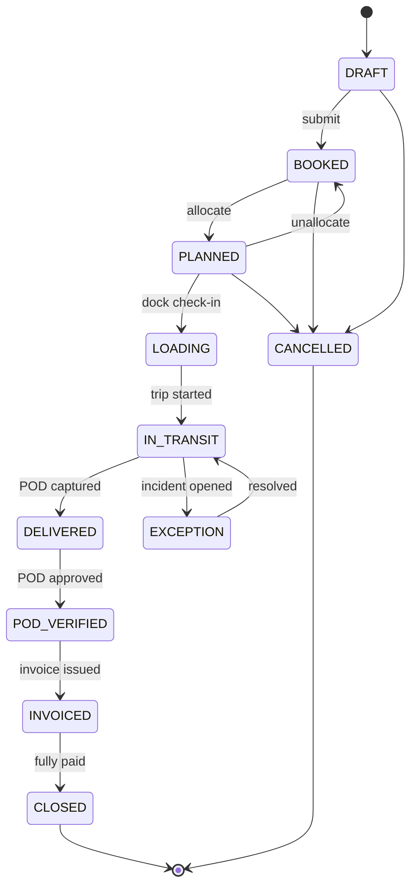

### 4.2 Trip & stop

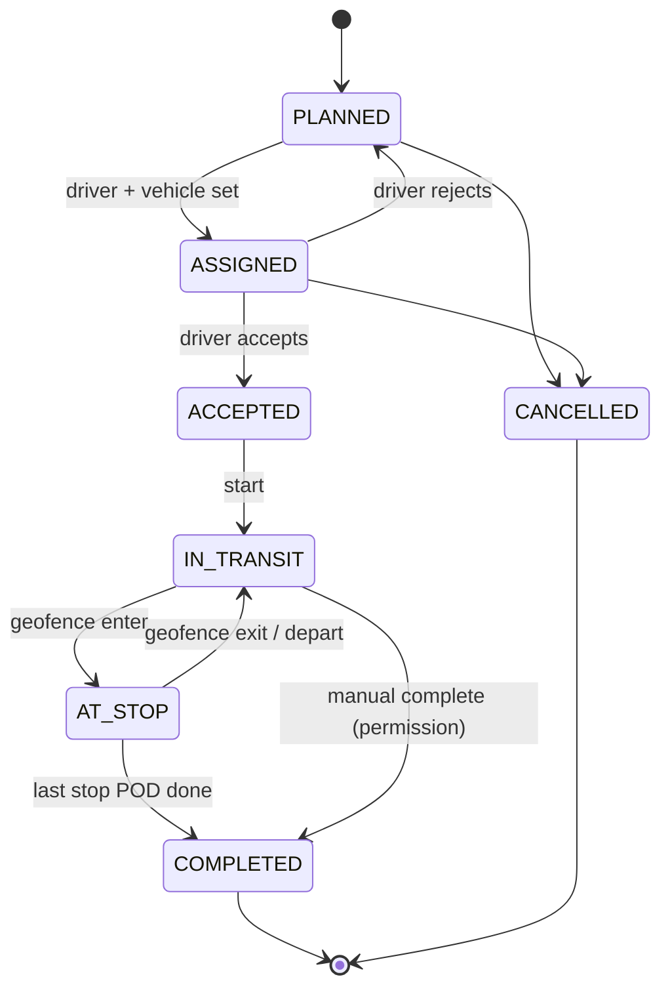

Each `trip_stop` runs its own machine: `PENDING → ARRIVED → (LOADING|UNLOADING) → DEPARTED | SKIPPED`. Detention = `departed_at − arrived_at − tenant_configs.detention_grace_hours`.

### 4.3 Invoice

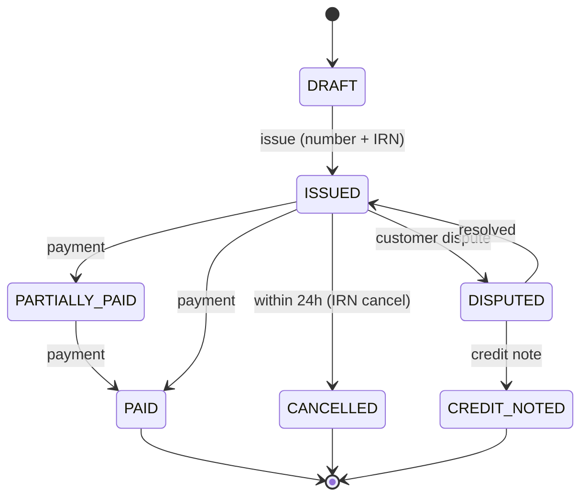

### 4.4 Vehicle, driver, incident, action proposal

| Entity | States | Notes |
|---|---|---|
| Vehicle | `AVAILABLE → RESERVED → ON_TRIP → AVAILABLE`; `MAINTENANCE`; `BLOCKED_COMPLIANCE`; `INACTIVE` | `BLOCKED_COMPLIANCE` is set by the nightly sweep. The allocator skips it. |
| Driver | `AVAILABLE`, `ON_TRIP`, `OFF_DUTY`, `ON_LEAVE`, `SUSPENDED` | `SUSPENDED` follows an expired licence or failed verification |
| Incident | `OPEN → INVESTIGATING → (AUTO_RESOLVED \| RESOLVED \| ESCALATED) → CLOSED` | |
| Action proposal | `PROPOSED → (AUTO_APPROVED \| PENDING_APPROVAL) → APPROVED → EXECUTING → (EXECUTED \| FAILED)`; `REJECTED`; `EXPIRED` | Today an approval only flips a flag and nothing executes (`src/lib/agents/core/eventGraph.ts`, `resolveApproval`) |

---

## 5. API design

### 5.1 Principles

- Base path `/api/v1`. Resources are nouns. **State changes are command sub-resources** (`POST /orders/{id}/allocate`), replacing the `_action` field in `PATCH` bodies.
- `PATCH` accepts only an allow-listed, zod-validated subset of editable fields (e.g. notes, contact). Status is never patchable.
- Auth: session cookie (console and portal), `Authorization: Bearer <api_key>` (partners), `Authorization: Device <token>` (driver PWA).
- `Idempotency-Key` header is required on every `POST` that creates or executes. It is stored for 24 h in Redis.
- `If-Match: <version>` on commands against versioned aggregates. Returns `409 VERSION_CONFLICT` on mismatch.
- Cursor pagination: `?limit=50&cursor=<opaque>`. Filters: `?status=BOOKED,PLANNED&customerId=…&q=…`.

### 5.2 Response & error envelope

```jsonc
// 2xx
{ "data": { /* resource or list */ }, "meta": { "nextCursor": "…", "requestId": "req_…" } }

// 4xx / 5xx
{ "error": { "code": "VEHICLE_OVER_CAPACITY", "message": "Order weight 9,200 kg exceeds remaining capacity 7,500 kg",
             "details": { "vehicleId": "…", "remainingKg": 7500 } },
  "meta": { "requestId": "req_…" } }
```

Error codes: `UNAUTHENTICATED`, `FORBIDDEN`, `NOT_FOUND`, `VALIDATION_FAILED`, `INVALID_TRANSITION`, `VERSION_CONFLICT`, `IDEMPOTENCY_REPLAY`, `RATE_LIMITED`, `PLAN_LIMIT_REACHED`, `INTEGRATION_UNAVAILABLE`, plus domain codes. Never return `String(err)` to clients (today: `src/app/api/compliance/check/route.ts`).

### 5.3 Endpoint catalogue (v1)

| Area | Endpoints |
|---|---|
| Auth | `POST /auth/login` · `POST /auth/logout` · `POST /auth/signup` · `POST /auth/otp/request` · `POST /auth/otp/verify` (driver) · `GET /me` · `POST /auth/switch-tenant` |
| Tenancy | `GET/PATCH /tenant` · `GET/PATCH /tenant/config` · `GET /tenant/entitlements` · `GET/POST/DELETE /tenant/members` · `GET/POST/DELETE /tenant/api-keys` |
| CRM | `GET/POST /leads` · `PATCH /leads/{id}` · `POST /leads/{id}/convert` · `POST /quotes` · `POST /quotes/instant` *(public, rate-limited)* |
| Customers | `GET/POST /customers` · `GET/PATCH /customers/{id}` · `GET/POST /customers/{id}/locations` |
| Orders | `GET/POST /orders` · `POST /orders/bulk` (CSV/XLSX) · `GET/PATCH /orders/{id}` · `POST /orders/{id}/{submit,allocate,unallocate,cancel}` · `GET /orders/{id}/timeline` |
| Dispatch | `GET /dispatch/recommendations?orderId=` · `POST /dispatch/auto-plan` |
| Trips | `GET /trips` · `GET /trips/{id}` · `POST /trips/{id}/{accept,reject,start,complete,cancel}` · `POST /trips/{id}/stops/{stopId}/{arrive,depart}` · `GET /trips/{id}/track` (polyline + pings) |
| Telemetry | `POST /telemetry/pings` (batch ≤ 100) · `GET /fleet/positions` · `POST /webhooks/gps/{vendor}` |
| Warehouse | `GET/POST /warehouses/{id}/dock-slots` · `POST /orders/{id}/items/{itemId}/scan` |
| POD | `POST /uploads/presign` · `POST /trips/{id}/stops/{stopId}/pod` · `POST /pods/{id}/approve` |
| Fleet | `GET/POST /vehicles` · `GET/PATCH /vehicles/{id}` · `POST /vehicles/{id}/documents` · `POST /vehicles/{id}/maintenance` |
| Drivers | `GET/POST /drivers` · `GET/PATCH /drivers/{id}` · `POST /drivers/{id}/documents` · `POST /drivers/{id}/verify` · `GET/POST /drivers/{id}/messages` |
| Billing | `GET /invoices` · `POST /invoices` (draft from orders) · `POST /invoices/{id}/{issue,cancel,dispute}` · `GET /invoices/{id}/pdf` · `POST /invoices/{id}/payment-link` · `POST /webhooks/payments/{gateway}` |
| Compliance | `GET /compliance/summary` · `POST /eway-bills` · `POST /eway-bills/{id}/{update-vehicle,extend,cancel}` |
| Intelligence | `GET /ops/brief` · `GET /ops/queue` · `POST /ops/proposals/{id}/{approve,reject}` · `PATCH /tenant/config/autonomy` · `POST /copilot/ask` |
| Public | `GET /public/track/{token}` · `POST /public/leads` · `POST /public/quote` |
| Webhooks out | Events: `order.booked`, `order.allocated`, `trip.started`, `trip.eta_changed`, `stop.arrived`, `pod.captured`, `invoice.issued`, `payment.received`, `incident.opened` |

### 5.4 Example command: allocate

```http
POST /api/v1/orders/0192f…/allocate
Idempotency-Key: 6c1e…
If-Match: 3
Content-Type: application/json

{ "vehicleId": "0192f…", "driverId": "0192f…", "plannedStartAt": "2026-10-18T05:30:00+05:30",
  "override": { "reason": "Customer requested reefer", "ignore": ["DRIVER_HOURS"] } }
```

```jsonc
// 201
{ "data": { "order": { "id": "…", "number": "ORD-2026-000123", "status": "PLANNED", "version": 4 },
            "trip":  { "id": "…", "number": "TRP-2026-000088", "status": "ASSIGNED",
                       "stops": [ { "seq": 1, "kind": "PICKUP" }, { "seq": 2, "kind": "DROP" } ] } } }
```

The service checks, in order: permission `order.allocate`; order is `BOOKED`; vehicle is `AVAILABLE` and not compliance-blocked; capacity fits; driver is `AVAILABLE` with a valid licence; plan limits. It then runs one transaction: update order, insert trip and stops, set vehicle `RESERVED`, set driver `ON_TRIP`, append to outbox `ORDER_ALLOCATED`, write the audit log.

### 5.5 Public tracking response

```jsonc
GET /api/v1/public/track/k7Qm2xPZr9   // 10-char random token, not the order number
{ "data": {
  "number": "ORD-2026-000123", "status": "IN_TRANSIT",
  "origin": { "city": "Pune" }, "destination": { "city": "Bengaluru" },
  "eta": { "at": "2026-10-18T19:40:00+05:30", "confidence": 0.82, "reason": "Traffic near Hubballi (+25 min)" },
  "position": { "lat": 15.36, "lng": 75.12, "at": "…" },          // rounded to ~100 m
  "milestones": [ { "type": "PICKED_UP", "at": "…" }, { "type": "TOLL_CROSSED", "label": "Kini Toll", "at": "…" } ],
  "vehicle": { "type": "32ft MXL", "registrationMasked": "MH12 •• 4521" },
  "driver": { "firstName": "Ramesh", "callMaskedNumber": "+91 80 4710 0000" },   // never the real phone
  "pod": null,
  "realtime": { "channel": "public:trk:k7Qm2xPZr9", "tokenUrl": "/api/v1/public/track/k7Qm2xPZr9/rt-token" }
} }
```

---

## 6. Key sequence flows

### 6.1 Allocate & dispatch

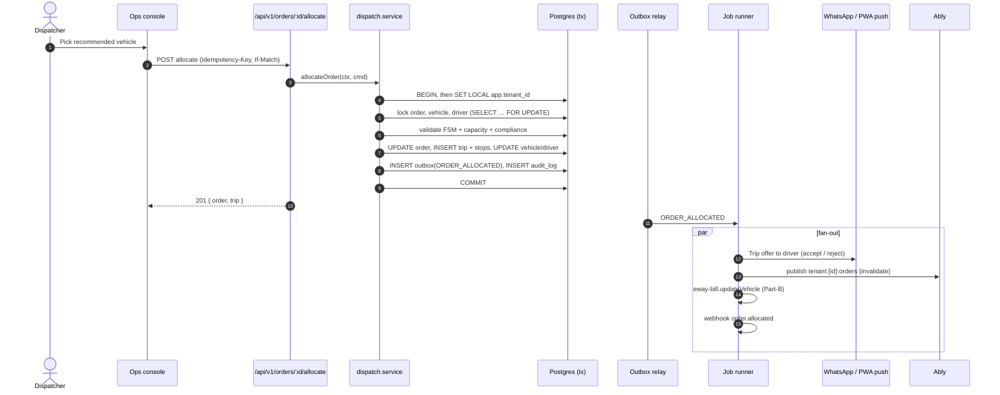

### 6.2 Telemetry ingest → live map → ETA

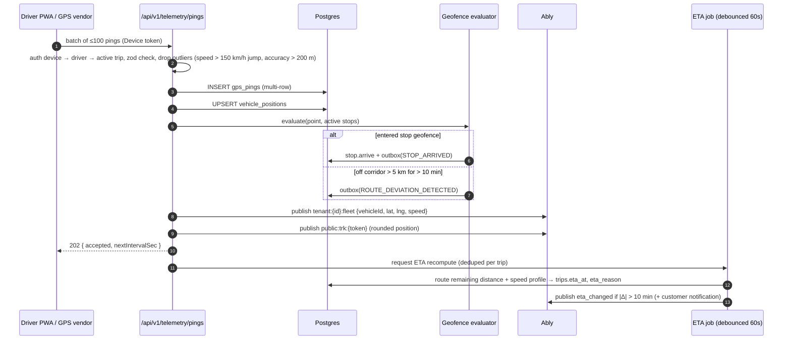

### 6.3 Exception → policy → approval → execution

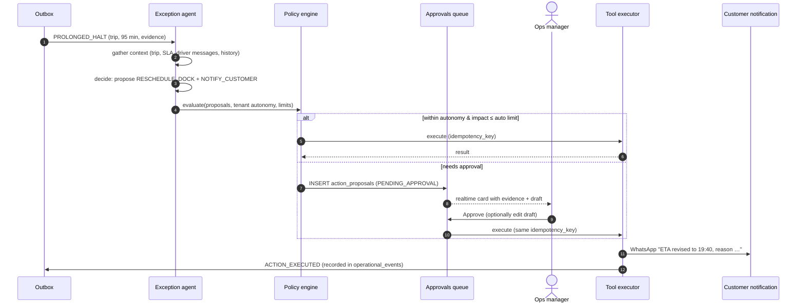

### 6.4 POD → invoice → payment

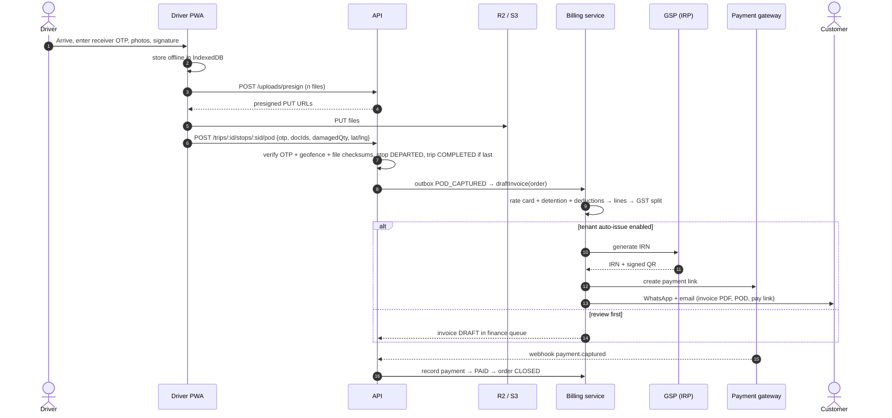

### 6.5 Instant quote (marketing site)

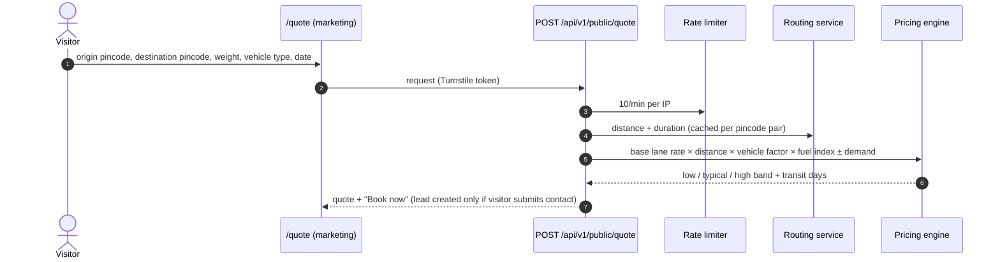

---

## 7. Module designs

### 7.1 Identity, sessions & RBAC

**Session.** Keep the HMAC cookie format from `src/lib/auth.ts`, but make the payload carry only `{ sid, uid, tid, exp }`. Each request loads `sessions` (cached 60 s in Redis) to check revocation, role and tenant. Logout and password change revoke the row.

**Built so far (2026-10-18):**

- *Sessions.* Sign-in, signup and invite acceptance create a `sessions` row (`src/lib/sessions.ts`). The token carries its `sid`. `requireAuth` refuses a token without a `sid`, or one whose row is revoked, expired or belongs to another user. The check is cached per server instance for 30 s. A revocation made on the same instance applies at once. Sign-out revokes the session. A role change or removal revokes all of that member's sessions in the workspace. The token still carries role and name for the UI; trimming it to `{ sid, uid, tid, exp }` waits for the Redis cache.
- *Fail closed.* `getSecret()` throws in production when `AUTH_SECRET` is missing or shorter than 32 characters.
- *Permissions.* `src/lib/permissions.ts` holds the matrix for the five staff roles: Operations Director, Fleet Dispatcher, Warehouse Supervisor, Compliance Officer and Finance Manager. Every mutating route calls `requirePermission(session, '<permission>')` and returns 403 with the caller's role in the message. Reads stay open to every role in the workspace. `orders/[id]`, `trips/[id]`, `drivers/[id]` and `agent/queue` pick the permission from what the request changes (for example, scanning needs `warehouse.load` and an allocation override needs `order.allocate.override`).
- *Team.* `/settings/team` (Directors only) invites by email and role, changes roles and removes members. An invite is a one-time link (`/invite/<token>`, 7 days) to share on WhatsApp or by email; only its SHA-256 hash is stored. A new person picks a name and password; someone who already has an account confirms their password, and the workspace is added to it. A workspace always keeps at least one Director, and nobody can change or remove themselves.

**Roles → permissions** (`src/server/core/permissions.ts`):

| Permission | Owner | Ops Director | Dispatcher | Warehouse | Compliance | Finance | Driver | Customer |
|---|:-:|:-:|:-:|:-:|:-:|:-:|:-:|:-:|
| `order.create` | ✓ | ✓ | ✓ | | | | | ✓ (own) |
| `order.allocate` | ✓ | ✓ | ✓ | | | | | |
| `trip.complete.manual` | ✓ | ✓ | | | | | | |
| `trip.stop.update` | ✓ | ✓ | ✓ | ✓ | | | ✓ (own) | |
| `pod.capture` | ✓ | ✓ | ✓ | | | | ✓ (own) | |
| `invoice.issue` | ✓ | ✓ | | | | ✓ | | |
| `invoice.view` | ✓ | ✓ | | | | ✓ | | ✓ (own) |
| `fleet.manage` | ✓ | ✓ | ✓ | | ✓ | | | |
| `compliance.manage` | ✓ | ✓ | | | ✓ | | | |
| `autonomy.configure` | ✓ | ✓ | | | | | | |
| `proposal.approve` | ✓ | ✓ | ✓ (≤ limit) | | | ✓ (financial) | | |
| `tenant.members` | ✓ | | | | | | | |

```ts
// usage in every service command
authorize(ctx, 'order.allocate');                       // throws FORBIDDEN
authorize(ctx, 'invoice.view', { customerId: inv.customerId }); // scoped check for customers
```

### 7.2 Dispatch — allocation scoring

This replaces the client-side filter in `src/features/allocation/hooks.ts`, which picks the first fitting vehicle and ignores distance, cost and compliance. Scoring runs on the server.

**Hard constraints** (vehicle is excluded, with a reason shown in the UI):
`status ∈ {AVAILABLE}` · not `BLOCKED_COMPLIANCE` · `capacity_kg − current_load ≥ order.weight` · volume fits · reefer if cold-chain · driver valid licence class for the vehicle · driver hours rest rule · vehicle documents valid for the trip window.

**Soft score** (0–100, weights configurable in `tenant_configs.dispatch_weights`):

```text
score = 30 × proximity      (1 − deadhead_km / max_deadhead_km)
      + 20 × utilisation    (order.weight / capacity, peak at 85–95%)
      + 15 × on_time_prob   (ETA to pickup ≤ pickup window, from routing)
      + 15 × cost           (1 − normalised(deadhead_cost + lane_cost))
      + 10 × driver_score   (safety_score / 100, acceptance rate)
      + 10 × lane_affinity  (driver/vehicle history on this lane, home-base return)
```

`GET /dispatch/recommendations?orderId=` returns the top 5 with a per-factor breakdown. The UI renders it as an "explain" bar so the dispatcher can see why a vehicle was chosen. Phase 4 adds multi-order consolidation (VRP via OR-Tools, Timefold or a routing provider's optimiser).

### 7.3 Execution — ETA engine

| Step | Detail |
|---|---|
| Inputs | Remaining route polyline (routing provider), current position and speed, historic speed profile per lane segment and hour of day, driver rest-stop pattern, live incidents |
| v1 (deterministic) | `eta = now + Σ(segment_km / expected_speed(segment, hour)) + planned_halts + unload_time` |
| v2 (learned) | Gradient-boosted model on completed trips. Features: lane, vehicle type, hour, weekday, weather, driver, stop count. Output is p50 and p90 → "ETA 19:40 (likely between 19:10 and 20:30)". |
| Explainability | Store `eta_reason` from the dominant delta: traffic, long halt, deviation, loading delay |
| Triggers | Debounced recompute ≤ once per 60 s per trip. Customer notified when it moves > 15 min or crosses the SLA. |

### 7.4 Geofencing

- Each `location` has a `point` and `geofence_radius_m` (default 300 m; polygons allowed later).
- Enter: 2 consecutive pings inside the radius with speed < 10 km/h → `STOP_ARRIVED`.
- Exit: 2 consecutive pings outside the radius + 50 m hysteresis → `STOP_DEPARTED`.
- Corridor: distance from the planned route polyline (`ST_Distance(route, point)`) > `tenant_configs.deviation_km` for > 10 min → `ROUTE_DEVIATION_DETECTED`.
- Halt: speed < 3 km/h for > `halt_threshold_min` outside a known stop or fuel/rest POI → `PROLONGED_HALT`.
- GPS silence: no ping for > 20 min on an active trip → `GPS_OFFLINE` (driver nudge, then dispatcher alert).

### 7.5 Billing & GST

Today `src/app/api/invoices/route.ts` hard-codes ₹2,000 loading, ₹1,500 unloading and a single 18% GST line, with no CGST/SGST/IGST split and no reverse-charge support. Target design:

**Charge lines** come from the contract's rate card: base freight (per trip, per kg, per km or per tonne-km), loading/unloading, detention (hours × rate beyond grace), multi-point charges, tolls (pass-through, optionally from FASTag data), minus deductions (damage, shortage, delay penalty per contract).

**Tax scheme** is set per tenant per financial year (GTA declaration) and can be overridden per customer:

| Scheme | GST charged on invoice | Notes |
|---|---|---|
| `GTA_RCM_5` | 0 (invoice states "tax payable on reverse charge") | Recipient pays 5% |
| `GTA_FCM_5` | 5%, no ITC for the GTA | |
| `GTA_FCM_18` | 18%, with ITC | Replaced the 12% option from 22 Sep 2025 |
| `NON_GTA_18` | 18% | E.g. a pure vehicle-hire contract (verify per contract) |

**Split:** if supplier state = place-of-supply state → CGST = SGST = rate / 2; otherwise IGST = rate. SAC 9965 (GTA codes 996791 / 996792). Round each tax component to the paisa; the invoice total is rounded per GST rules.

> Tax rates live in a versioned `tax_rules` table, not in code. Have a CA confirm them before go-live; the Sept 2025 rationalisation changed GTA rates.

**Issue:** `DRAFT → ISSUED` assigns the gapless number, calls IRP for the IRN and signed QR (B2B, when the tenant is over the e-invoice threshold), renders the PDF (`@react-pdf/renderer`, existing `src/features/invoices/InvoicePdf.tsx`), stores it in R2, and emits `INVOICE_ISSUED`.

**Collections:** a dunning schedule per customer (T−3 reminder, T+1, T+7, T+15 escalation) runs as durable jobs. Payment webhooks auto-allocate against the oldest open invoices.

### 7.6 Compliance

| Check | Source | Action |
|---|---|---|
| Driver licence expiry (30 / 7 / 0 days) | `drivers.licence_valid_until`, SARATHI re-verify | Alert → `SUSPENDED` at expiry |
| Vehicle RC, fitness, insurance, PUC, permit | `vehicle_documents`, VAHAN | Alert → `BLOCKED_COMPLIANCE` at expiry |
| E-way bill validity | `eway_bills.valid_until` vs trip ETA | Auto-extend proposal 8 h before expiry |
| Service overdue | `maintenance_records` vs km / days policy | Alert, soft-block |

The nightly cron (`vercel.json`) must authenticate the way Vercel sends it: `Authorization: Bearer ${CRON_SECRET}`. Today the route checks a custom `x-cron-secret` header (`src/app/api/compliance/check/route.ts:33`), so production cron calls get a 401.

### 7.7 Intelligence (EdgePilot)

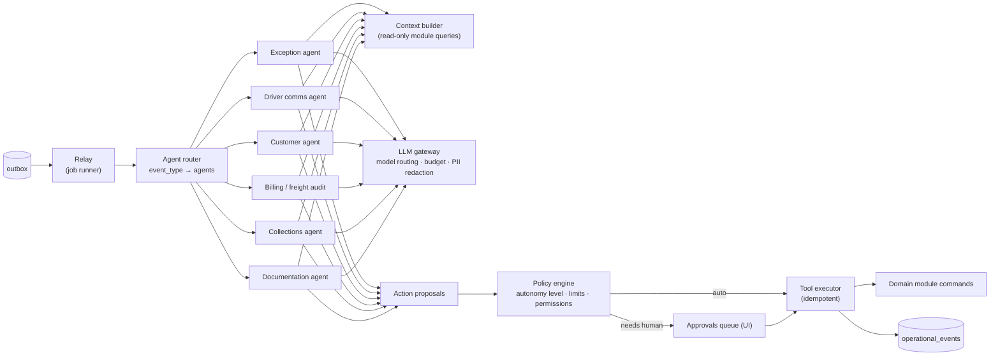

**Agent contract.** Keep the existing `AgentModule` interface (`src/lib/agents/core/types.ts`) and add three things: `tenantId` in every event; agents return **proposals**, never raw DB writes; tools are zod-typed and call domain commands, so the same validation, authorisation and audit apply.

```ts
interface ToolDef<I, O> {
  name: 'NOTIFY_CUSTOMER' | 'RESCHEDULE_DOCK' | 'REASSIGN_VEHICLE' | 'HOLD_INVOICE' | 'EXTEND_EWAY_BILL' | …;
  input: z.ZodType<I>;
  requiredLevel: AutonomyLevel;           // 0–5, as today
  impact(input: I, ctx: TenantContext): Promise<Money>;
  execute(input: I, ctx: TenantContext, idempotencyKey: string): Promise<O>;
}
```

**Policy engine.** `requiresApproval = tenantConfig.autonomyLevel < tool.requiredLevel || impact > tenantConfig.autoApproveLimit`. Autonomy level is read from `tenant_configs`. Today it is a static in-memory class field (`src/lib/agents/core/actionEngine.ts:27`) shared by every tenant and reset on every cold start.

**Driver NLU.** Pipeline: normalise (transliterate Hinglish) → LLM classify into `{intent, delayMinutes, location, reason, confidence}` with a JSON schema → if confidence < 0.6 or the LLM is unavailable, fall back to today's regex rules (`src/lib/agents/modules/driver/index.ts:174`) → reply in the driver's preferred language. Use a small, fast model for classification and a stronger model for multi-step exception reasoning. The gateway enforces per-tenant monthly token budgets (`usage_counters.ai_actions_count`).

**Safety rails:** maximum event recursion depth of 3; per-trip action cooldown; every proposal stores `evidence` (telemetry, messages, contract rule) shown in the approval card; a kill switch per tenant.

**Metrics honesty:** ROI tiles ("hours saved", "leakage prevented") are computed only from executed actions with measured impact. Remove the `Math.max(…, 142)` style floors (`src/lib/agents/core/eventGraph.ts:187-190`) and the hard-coded fallbacks in `src/app/api/agent/brief/route.ts`.

### 7.8 Notifications

- Channel adapters: WhatsApp (template messages + session replies), SMS, email, web push, in-app.
- Template registry per event and language (`notification_templates`), with tenant branding.
- Preferences per customer contact and per driver. Quiet hours for non-critical messages.
- Every send is a `notifications` row (`queued → sent → delivered → read | failed`), with delivery webhooks.

### 7.9 Realtime channels (Ably)

| Channel | Subscribers | Capability |
|---|---|---|
| `tenant:{tid}:fleet` | Ops console | subscribe |
| `tenant:{tid}:orders` / `:trips` / `:queue` | Ops console | subscribe (query invalidation) |
| `tenant:{tid}:driver:{did}` | Driver PWA, dispatcher chat | publish + subscribe |
| `portal:{tid}:{customerId}` | Customer portal | subscribe |
| `public:trk:{token}` | Public tracking page | subscribe only, 1-hour token |

Clients get tokens from `GET /api/v1/realtime/token`, which signs an Ably token request limited to the channels above. The API key never reaches the browser. Today the server publishes to global `gps` and `alerts` channels (no tenant scoping) and no client subscribes.

### 7.10 Scheduled & background jobs

| Job | Schedule | Notes |
|---|---|---|
| Outbox relay | continuous (or every 10 s) | `SELECT … FOR UPDATE SKIP LOCKED LIMIT 100` |
| Compliance sweep | daily 01:00 IST | Per tenant, fan-out |
| SLA watcher | every 5 min | Trips at risk → proposals |
| ETA recompute | event-driven, debounced | |
| Dunning | daily 10:00 IST | |
| GPS partition maintenance | monthly | Create next partition, drop expired ones |
| Usage metering | hourly | `usage_counters` → plan limits |
| Webhook retries | exponential backoff to 24 h | Dead-letter after 10 attempts |

---

## 8. Frontend design

### 8.1 Rendering strategy

| Surface | Strategy |
|---|---|
| Marketing | Static + ISR. Interactive islands only (quote widget, demo map, ROI calculator). |
| Ops console | Server Component shell with first data fetched on the server (no blank screen; today `src/app/(dashboard)/layout.tsx` returns `null` until a client auth check finishes). Client islands for tables, map and chat. |
| Portal | Same as console, with a smaller nav |
| Public tracking | Server-rendered (shareable, crawl-blocked) + realtime island |
| Driver PWA | Client-first, app-shell cached by a service worker |

### 8.2 Client data layer

- **TanStack Query** for all client reads and writes. Query keys: `['orders', tenantId, filters]`, `['trip', id]`, `['fleet-positions', tenantId]`.
- **Ably → invalidation:** one `RealtimeProvider` subscribes to the tenant channels and calls `queryClient.invalidateQueries` or `setQueryData` on events. This replaces `setInterval` polling (`src/app/(dashboard)/tracking/page.tsx:51`).
- **Mutations:** optimistic updates with rollback. Every mutation checks `res.ok` and shows the error envelope's message (today `src/features/orders/hooks.ts` ignores failed responses, which hides the broken transactions).
- **Forms:** react-hook-form + the module's zod schema (shared with the API).
- **URL state:** filters, sort, selected row and map viewport live in search params, so views are shareable.

### 8.3 Interaction design — what makes it feel top-tier

| Pattern | Where | Detail |
|---|---|---|
| Command palette (⌘K) | Everywhere | Jump to any order, trip, vehicle or driver; run actions ("allocate ORD-…", "call driver of TRP-…") |
| Live control-tower map | Dashboard, tracking | MapLibre GL, clustered trucks, smooth marker interpolation between pings, heat-layer for delays, click → side sheet |
| Dispatch board | Allocation | Kanban by status (Booked → Planned → Loading → In transit), drag order onto a vehicle lane, capacity bar animates, explain-score popover |
| Trip timeline | Order and trip detail | Vertical event graph (ingest, allocation, tolls, halts, AI actions) with evidence chips |
| Approval cards | EdgePilot queue | Evidence, proposed action and editable message draft; approve with `A`, reject with `R`; undo toast |
| Data tables | All lists | TanStack Table + virtualisation, column chooser, saved views, bulk actions, CSV export |
| Inline everything | Detail sheets | Edit in place, no full-page forms for small edits |
| Empty states that teach | All pages | "No vehicles yet → Import from Excel / Add first truck / Connect GPS vendor" (never fake numbers) |
| Skeletons + optimistic UI | All | Under 100 ms perceived response |
| Keyboard-first | Console | `j/k` move rows, `enter` open, `e` edit, `?` shortcut sheet |
| Notifications centre | Header | Realtime, grouped, deep-linked |
| Theming & i18n | Global | Light/dark (tokens in `globals.css`), English and Hindi, INR and lakh/crore formatting |

### 8.4 Marketing site components

| Component | Purpose |
|---|---|
| Instant quote widget | Pincode → pincode, weight, vehicle type → price band and transit days (flow 6.5). Today `src/components/home/QuoteRequest.tsx:124-163` derives distance from city-name letter codes, prices in USD, and never submits. |
| Track box in the hero | Paste a tracking link or ID → public tracking page |
| Live network map (anonymised) | Real active-lane counts animate on an India map (social proof that is actually true) |
| ROI calculator | Reuse `src/lib/onboarding/scoring.ts` → "save X hours and ₹Y per month" |
| Interactive product tour | Click-through of the real console on a seeded sandbox tenant |
| Persona pages | Fleet owners, 3PLs, brokers, shippers (as ambry.io does for carriers, brokers and shippers) |
| Trust page | Security, DPDP, uptime status, data residency (India) |
| Hero animation | Replace 249 WebP frames (12 MB in `public/frames`) with a scroll-scrubbed ~1.5 MB video or a progressive frame loader. Respect `prefers-reduced-motion`. |

### 8.5 Accessibility & performance budgets

- WCAG 2.1 AA: focus rings, ARIA on custom widgets (`ContextMenu`, `Dialog`, `Drawer`), contrast tokens checked, map data also available as a list.
- JS budget: < 200 KB gzipped for the console first load. Leaflet/MapLibre, Recharts and react-pdf are lazy-loaded.
- Core Web Vitals on marketing: LCP < 2.5 s, CLS < 0.1, INP < 200 ms.

---

## 9. Driver PWA

| Concern | Design |
|---|---|
| Auth | Phone OTP → device token (hashed in `driver_devices`), revocable by dispatcher. Replaces the unauthenticated `/driver-app?v=&t=` link. |
| Permissions | The `Permissions-Policy` header for `/d/*` must allow `geolocation=(self)` and `camera=(self)`. Today `src/middleware.ts:111` sends `geolocation=()` on every route, so the browser blocks the driver app's own GPS. |
| GPS | `watchPosition` (high accuracy) while a trip is active. Adaptive interval: 10 s moving, 60 s stationary. Wake Lock API to keep tracking while the screen is on. |
| Offline | IndexedDB queues for pings, POD drafts, messages and expenses. Background Sync flushes them on reconnect. Pings keep `recorded_at` from the device. |
| Screens | Today's trips → trip detail (stops, navigate via Google Maps intent) → arrive / depart → POD (OTP, photos, signature, damage) → chat → expenses (fuel, toll, food with receipt photo) → profile and documents |
| Language | Hindi first, English toggle, large tap targets, voice notes in chat |
| Native later | Move to Expo when background-location reliability (screen off) becomes a must-have |

---

## 10. Cross-cutting concerns

### 10.1 Transactions & the outbox

```ts
// src/server/core/db.ts
import { Pool } from '@neondatabase/serverless';
import { drizzle } from 'drizzle-orm/neon-serverless';
export const pool = new Pool({ connectionString: env.DATABASE_URL });
export const db = drizzle(pool, { schema });

export async function withTenantTx<T>(ctx: TenantContext, fn: (tx: Tx) => Promise<T>) {
  return db.transaction(async (tx) => {
    await tx.execute(sql`select set_config('app.tenant_id', ${ctx.tenantId}, true)`);
    return fn(tx);
  });
}

export async function emit(tx: Tx, ctx: TenantContext, type: DomainEventType, aggregateId: string, payload: unknown) {
  await tx.insert(outbox).values({ tenantId: ctx.tenantId, eventType: type, aggregateId, payload });
}
```

### 10.2 Security headers

One definition in `proxy.ts`, with per-route overrides. Remove the duplicate block in `next.config.ts` (the two CSPs disagree today).

```ts
const base = { 'Permissions-Policy': 'camera=(), microphone=(), geolocation=(), payment=()' };
const driverApp = { 'Permissions-Policy': 'camera=(self), microphone=(self), geolocation=(self)' };
// CSP: nonce-based script-src (drop 'unsafe-eval' in production), connect-src limited to self, Ably, map tiles, Sentry
```

### 10.3 Rate limiting

**Today** (`src/lib/rateLimit.ts`, in memory, per server instance): login 8 / 15 min per email and 30 / 15 min per IP; signup 5 / hour per IP; invite lookup 60 / 15 min and invite acceptance 10 / 15 min per IP. Move to Upstash Redis so the limits hold across instances. The target limits:

| Endpoint | Limit |
|---|---|
| `POST /auth/login` | 5 / 15 min per email + 20 / 15 min per IP |
| `POST /auth/otp/request` | 3 / 10 min per phone |
| `GET /public/track/*` | 60 / min per IP |
| `POST /public/quote`, `/public/leads` | 10 / min per IP + Turnstile |
| `POST /telemetry/pings` | 30 / min per device |

### 10.4 Observability

- `pino` structured logs with `requestId`, `tenantId`, `userId`; never log secrets or full phone numbers.
- OpenTelemetry traces for route handler → service → DB → integration.
- Sentry for client and server errors, with release tagging.
- Business dashboards: ingest lag, ETA error (actual − predicted), on-time %, agent auto-resolution rate, approval latency.

### 10.5 Testing strategy

| Layer | Tooling | Must cover |
|---|---|---|
| Unit | Vitest | FSMs, scoring, GST split, ETA maths, policy engine, NLU fallback |
| Integration | Vitest + Testcontainers Postgres (or a Neon branch) | Every command in a transaction, RLS cross-tenant denial, outbox emission, idempotency |
| API contract | zod → OpenAPI, schema tests | Request/response shapes and error codes |
| E2E | Playwright | Book → allocate → start → ping → POD → invoice → pay; public tracking; driver PWA offline replay |
| Load | k6 | 330 pings/s ingest, live map fan-out |
| Security | ZAP baseline in CI; dependency audit | Auth bypass, IDOR, headers |

Today the repo has no automated tests (only scripts in `scratch/`).

### 10.6 Configuration & feature flags

- `env.ts` validates env vars with zod at boot (fail fast).
- Feature flags in `tenant_modules` (plan gating) plus `feature_flags` (gradual rollout), resolved server-side and exposed through `GET /tenant/entitlements`.

---

## 11. Migration plan from the current code

Each step is shippable on its own and keeps the app working.

| Step | Change | Files |
|---|---|---|
| 1 | Switch the DB driver to `neon-serverless` `Pool` so `db.transaction` works | `src/lib/db.ts` |
| 2 | Check `res.ok` in every feature hook and toast the error | `src/features/*/hooks.ts` |
| 3 | Add `requireAuth` to `agent/queue`, `agent/brief`, `agent/timeline`; device-token auth on `gps/ping` | `src/app/api/agent/*`, `src/app/api/gps/ping/route.ts` |
| 4 | Fix `Permissions-Policy` for the driver app; rename `middleware.ts` → `proxy.ts`; one source of headers | `src/middleware.ts`, `next.config.ts` |
| 5 | Replace `PATCH set(body)` with zod allow-lists | 5 `[id]/route.ts` files |
| 6 | Add `tenant_id` columns (nullable) → backfill the default tenant → `NOT NULL` → indexes → RLS | `src/lib/schema.ts` + generated migrations |
| 7 | Put `tenantId` in the login session and link users through `memberships` (signup currently doesn't store `tenantId` on the user) | `src/app/api/auth/login/route.ts`, `register-subscription/route.ts` |
| 8 | Introduce `src/server/modules/*`, starting with orders + dispatch; move route handlers to call services | new |
| 9 | Outbox + job runner; move agents off the in-request bus | `src/lib/agents/*` |
| 10 | Replace text time columns with `timestamptz`, money with paise, string IDs with UUID + number | schema migration with dual-write window |
| 11 | Public tracking by token; remove driver phone from the public payload | `src/app/api/track/[id]/route.ts` |
| 12 | Delete fabricated fallbacks in brief and metrics; add teaching empty states | `src/app/api/agent/brief/route.ts`, `eventGraph.ts` |
| 13 | Replace `db:push` with `drizzle-kit generate` + `migrate` in CI; reconcile `docs/schema.sql` with reality (or delete it) | `package.json`, `docs/` |
